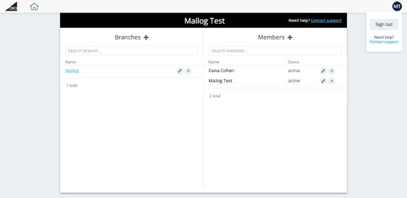

# אחרי ההתחברות

אחרי ההתחברות מופיע עמוד הפתיחה של החברה שלכם. **לחצו על שם החברה** תחת **Branches** כדי לפתוח את ההזמנות.

<button class="hotspot" style="left:23%;top:35.6%" data-tip="לחצו על שם החברה כדי לפתוח את ההזמנות">1</button>
<button class="hotspot" style="left:39.5%;top:18.7%" data-tip="הוספת סניף (מתקדם)">2</button>
<button class="hotspot" style="left:75%;top:18.7%" data-tip="הזמנת עמית לעבודה">3</button>
<button class="hotspot" style="left:12%;top:3%" data-tip="חזרה לעמוד הזה">4</button>
<button class="hotspot" style="left:93%;top:3%" data-tip="תפריט המשתמש: Sign out">5</button>

## מה יש בעמוד

| אזור | למה הוא משמש |
|---|---|
| **שם החברה** (הפס השחור) | החברה שלכם, כפי שהיא רשומה ב-Ordflow. |
| **Branches** | הסניפים של החברה. לרוב החברות יש סניף אחד. **לחצו על השם שלו** כדי לעבור ל[לוח ההזמנות](../orders/index.md). |
| **Members** | האנשים שיכולים להתחבר לחברה שלכם. לחצו על **+** כדי להזמין עמית, ועל העיפרון כדי לערוך משתמש. |
| **סמל הבית** (למעלה משמאל) | מחזיר לעמוד הזה מכל מקום ב-Ordflow. |
| **ראשי התיבות שלכם** (למעלה מימין) | תפריט המשתמש, עם **Sign out** (התנתקות). |

!!! info "סניפים: אפשרות מתקדמת"
    חברה יכולה לפתוח יותר מסניף אחד, למשל אחד בחיפה ואחד בירושלים. לכל סניף יש הזמנות והגדרות משלו.

!!! tip "צריכים עזרה?"
    שלחו מייל ל-[customer.service@mailogs.com](mailto:customer.service@mailogs.com).

**הבא:** [הגדרות ראשוניות ←](../setup/index.md)
