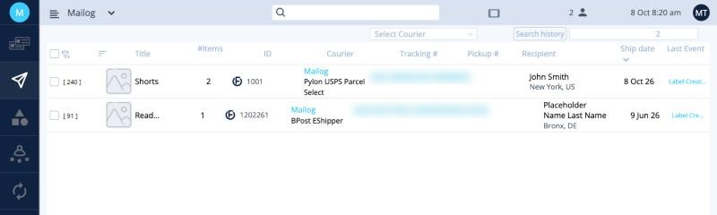
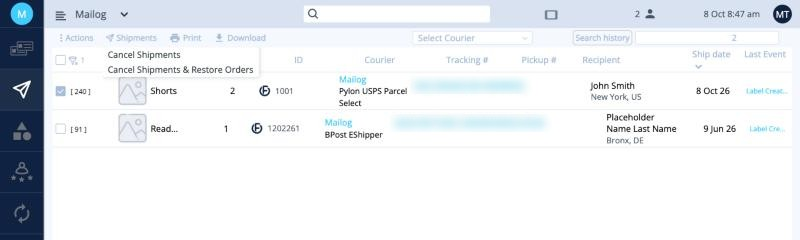
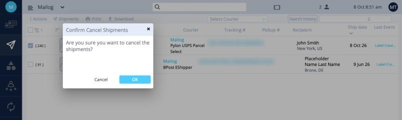
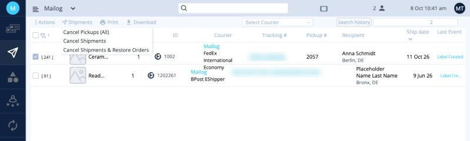
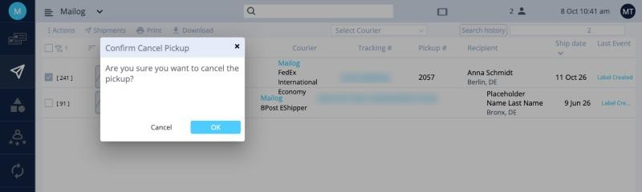

# Shipments

After you click **Finish**, your orders move to **Shipments**, the second icon in the left menu. Here you can follow your shipments and cancel labels.

| Column | Meaning |
|---|---|
| **Title** | The item name. |
| **#Items** | Number of different items. |
| **ID** | Your order number. |
| **Courier** | The service used for the label. |
| **Tracking #** | The tracking number. Click it to follow the parcel. |
| **Pickup #** | The pickup booking number, for courier pickups. |
| **Recipient** | Name and city. |
| **Ship date** | The day the label was created for. |
| **Last Event** | The latest tracking update from the carrier. |

!!! info "Right after the label is created"
    Until the carrier scans the parcel, **Last Event** shows something like *Label Created* or *Shipment information received*. That's normal: the parcel hasn't been scanned yet.

## Cancel a label, a shipment or a pickup {#cancel-a-label}

All cancellations are done here, in **Shipments**. Regular and Express shipments are cancelled the same way. Express shipments with a courier pickup have one extra option.

### Regular (Standard) shipment {#cancel-a-regular-shipment}

1. Tick the box next to the shipment.
2. Click **Shipments** in the toolbar and choose one of the options below.
3. Click **OK** to confirm.

<button class="hotspot" style="left:34%;top:22.5%" data-tip="Cancel the label and the order">1</button>
<button class="hotspot" style="left:34%;top:28.8%" data-tip="Cancel the label and put the order back on the board">2</button>

| Option | When to use it |
|---|---|
| **Cancel Shipments** | The order isn't going out at all. The label and the order are cancelled. |
| **Cancel Shipments & Restore Orders** | You need to change something and ship again, for example the customer changed their address. The label is cancelled and the order goes back to the board. |

### Express shipment with a pickup {#cancel-an-express-shipment}

Express shipments with a pickup have an extra option:

<button class="hotspot" style="left:34%;top:22.5%" data-tip="Cancel only the courier pickup">1</button>

| Option | What it does |
|---|---|
| **Cancel Pickups (All)** | Cancels **only the courier pickup**. The labels stay valid, so you can book a new pickup or drop the parcels off yourself. |
| **Cancel Shipments** | Cancels the labels and the order. |
| **Cancel Shipments & Restore Orders** | Cancels the labels and puts the orders back on the board. |

Each option asks you to confirm. Click **OK**.

## Complete

After you've sent the documents and forwarded them to ops@mailogs.com, select the shipments and choose **Actions › Complete**. They move to **Reports**. See [Shipping documents](documents.md#5-mark-the-shipments-as-complete).

**Next:** [Shipping documents →](documents.md)
