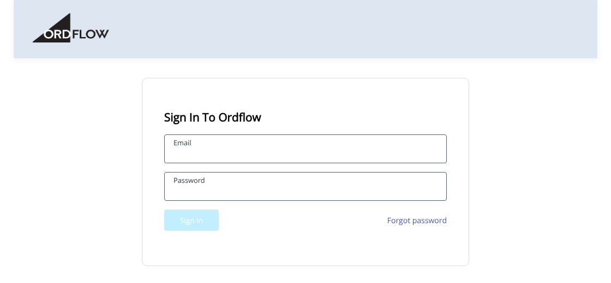
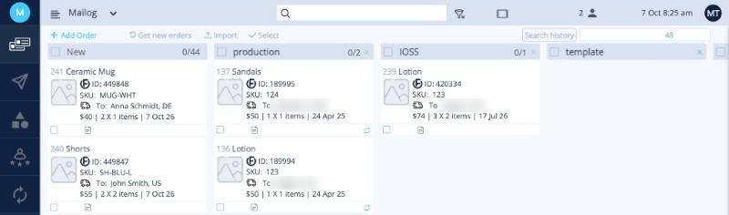
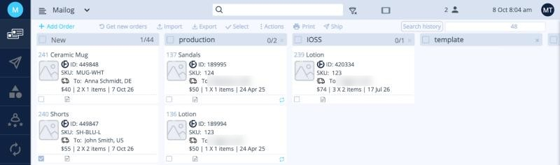
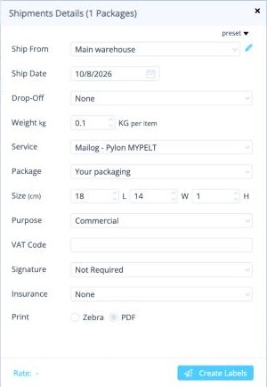
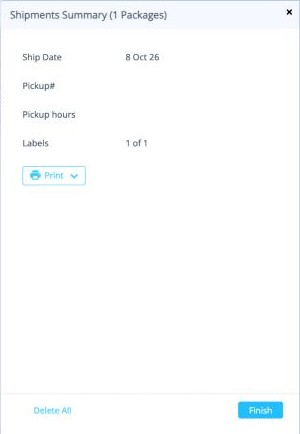
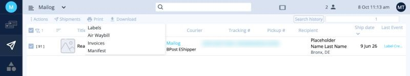
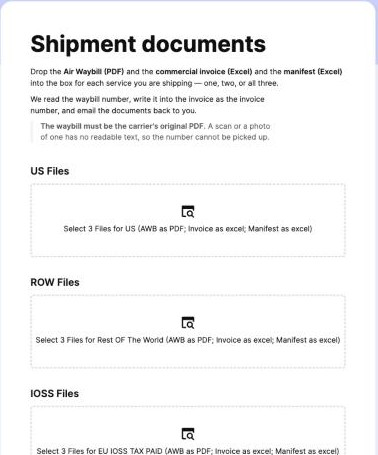

# התחלה מהירה: המשלוח הראשון שלכם

כל הדרך מההתחברות ועד האיסוף, שלב אחד לכל מסך. כל שלב מקשר להסבר המלא.

!!! tip "לפני המשלוח הראשון"
    בצעו פעם אחת את [ההגדרות הראשוניות](setup/index.md): מספר עוסק, כתובת שולח, פריסטים וחיבור החנות.

### 1. התחברות

היכנסו ל-[app.ordflow.com](https://app.ordflow.com) והתחברו עם המייל והסיסמה.

[התחברות ←](getting-started/login.md)

### 2. פתיחת החברה

לחצו על שם החברה תחת **Branches**.

[אחרי ההתחברות ←](getting-started/dashboard.md)

### 3. קבלת ההזמנות

הזמנות מהחנות המחוברת נכנסות לעמודה **New**. אפשר גם לייבא קובץ Excel דרך **Import**.

[לוח ההזמנות ←](orders/index.md) · [ייבוא מאקסל ←](orders/import.md)

### 4. בחירת ההזמנות של שירות אחד

סמנו את ההזמנות, או שימו אותן בשלב לכל שירות וסמנו את השלב. ואז לחצו על **Ship**.

[עבודה עם שלבים ←](orders/index.md#stages) · [כללי משלוח ←](orders/rules.md)

### 5. בחירת פריסט והפקת מדבקות

בחרו את ה**פריסט** של השירות, בדקו את המשקל (לכל פריט) ולחצו על **Create Labels**.

[הפקת מדבקות משלוח ←](orders/create-labels.md) · [אקספרס ←](orders/express.md)

{ width="260" }

### 6. הדפסת המדבקות וסיום

לחצו על **Print ‹ Labels**, הדביקו כל מדבקה על החבילה שלה ולחצו על **Finish**. המשלוחים עוברים ל-**Shipments**.

[הפקת מדבקות משלוח ←](orders/create-labels.md)

{ width="260" }

### 7. הדפסת המסמכים וסימון השקיות

ב-**Shipments** סננו לפי שירות, בחרו הכול, ואז **Print ‹ Air Waybill** (מספר שקיות), **Invoices** ו-**Manifest**. הדביקו AWB אחד בשקית שקופה על כל שקית.

[מסמכי משלוח ←](orders/documents.md) · [איך מסמנים שקית ←](service-guide/bag-labeling.md)

### 8. שליחת המסמכים

העלו את 3 הקבצים של כל שירות לטופס המסמכים. בדקו את המייל שתקבלו ו**העבירו אותו ל-ops@mailogs.com**.

[מסמכי משלוח ←](orders/documents.md)

{ width="260" }

### 9. הזמנת איסוף

באזור המרכז, הזמינו נהג Mailog. מחוץ למרכז, שלחו מייל ל-ops@mailogs.com לאיסוף של DHL. באקספרס האיסוף מוזמן יחד עם המדבקות.

[איסוף על ידי נהג Mailog ←](service-guide/driver-pickup.md) · [מחוץ למרכז ←](service-guide/dhl-pickup.md)

{ width="220" }

### 10. סימון המשלוחים כ-Complete

ב-**Shipments**, בחרו את המשלוחים ששלחתם ובחרו **Actions ‹ Complete**. אתם מוכנים למשלוחים הבאים.

[דוחות והיסטוריה ←](orders/reports.md)

