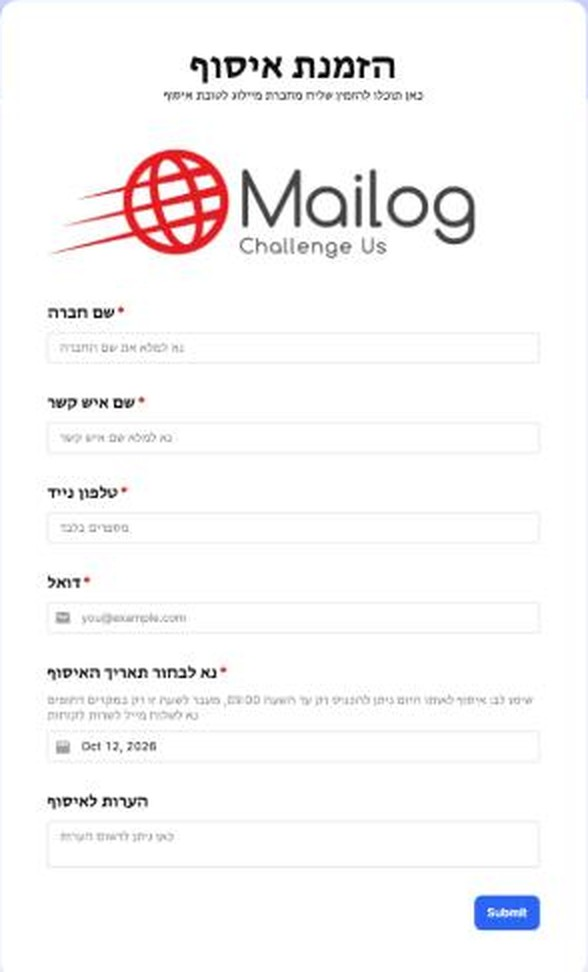

# Order a Mailog driver pickup (Center of Israel)

**Use this when:** you're sending **Standard** (non-Express) shipments from the **Center of Israel**. A Mailog driver collects the bags from you.

**Before you start:**

- [ ] Labels are created and printed ([how](../orders/create-labels.md))
- [ ] All bags are labelled ([how](bag-labeling.md))
- [ ] Paperwork is ready ([how](../orders/documents.md))

## Order the pickup

[Order a Mailog driver pickup](https://pickup.mailogs.co.il/order){ .md-button .md-button--primary }

The pickup form is in Hebrew. Fill in:

| Field | What to enter |
|---|---|
| **שם חברה** (company name) | Your company name. |
| **שם איש קשר** (contact name) | Who the driver should ask for. |
| **טלפון נייד** (mobile phone) | Numbers only. |
| **דואל** (email) | Where the confirmation is sent. |
| **נא לבחור תאריך האיסוף** (pickup date) | The day of the pickup. It's set to tomorrow by default. |
| **הערות לאיסוף** (notes) | Optional, for example the floor or the entrance. |

Then click **Submit**. You'll receive an **email confirming the pickup**.

<figure markdown>
{ width="300" }
</figure>

!!! warning "Same-day pickups: order by 09:00"
    A pickup for the same day can only be ordered until **09:00**. After that, for urgent cases only, email Mailog customer service at [customer.service@mailogs.com](mailto:customer.service@mailogs.com).

**Outside the Center?** See [Order a pickup outside the Center (DHL)](dhl-pickup.md).
